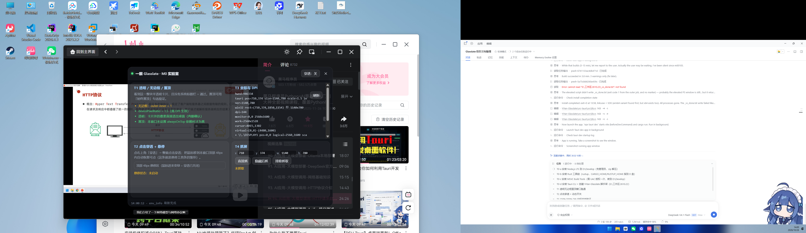

<div align="center">

# 一眼 Glasslate

**英文？一眼的事。**

框一处，译文就落在原文的位置上——不弹窗、不挪眼、不冻结屏幕。


</div>

---

**English** — Glasslate（一眼）is a lightweight Windows utility for translating the small bits of English that show up on screen. Select a region once and the translation is painted **in place of the original text** inside a frameless, always-on-top, fully transparent window. The screen is never frozen, so it keeps working over playing video, and the window remembers its rectangle so you never re-select the same area twice. Built with Tauri v2 + Rust; OCR uses the built-in `Windows.Media.OCR` (zero download), translation is bring-your-own-key with Aliyun Machine Translation as the default. **Status: pre-alpha** — M0 technical validation is complete, M1 main pipeline is in progress. Docs are in Chinese.

---

## 这是什么

屏幕上经常有一小片英文：IDE 的函数提示、报错信息、视频里的字幕、一张 PPT 的副标题。为了这几行字去开翻译软件、截图、粘贴，比看不懂更麻烦。

一眼 Glasslate 只想把这件事压缩成一次框选：

1. 按 `Alt+Q`，全屏暗下来，拖一个框
2. 松手，这块区域的英文被识别、翻译，**译文直接盖在原文的位置上**
3. 之后按 `Alt+W` 重新抓这一块再译一次——**不用再框一遍**

### 和同类工具的三点不同

| | 常见做法（如 Pot） | 本项目 |
|---|---|---|
| 译文放在哪 | 另开一个弹窗，原文译文两块并排 | **原位覆盖**：抹掉原文，译文画在它原来的位置上，字号自适应 |
| 重复操作 | 每次翻译都要重新全屏框选 | 玻璃窗**记住自己的屏幕矩形**，之后一个键重译 |
| 截屏瞬间 | 铺全屏遮罩，画面等于定格 | **不冻结**：窗口是真透明、真置顶，底下的视频继续播 |

### 界面原则（硬约束，不是"以后优化"）

1. 玻璃窗默认**没有任何 UI 元素**——没有标题栏、按钮、边框、logo，屏幕上只有译文
2. 工具条**只在鼠标悬停时浮现**，四个无字图标：重译 / 复制 / 关闭 / 设置
3. 抹除块的底色**采样自截图本身**，天然贴合背景；工具条与设置窗支持浅色 / 深色 / 跟随系统
4. 首次启动三步引导（选引擎 → 粘 AccessKey → 试翻一张），不超过一分钟
5. **专注模式**开关：一键关掉历史写入、悬停工具条、动画、离线预加载，只留"快捷键 → 翻译 → 覆盖显示"

---

## 现在到哪一步了

**这是一个还在早期的项目，没有可用的安装包。** 目前完成的是最容易翻车的地基验证（M0），产品界面一行都还没做。

M0 四项全部通过（2026-10-26，Windows 11 25H2 / 150% + 100% 双屏）：

| 编号 | 验证目标 | 结果 | 结论 |
|---|---|---|---|
| T1 | 透明 + 无边框 + 置顶窗口 | ✅ 通过 | 卡片外像素完全透出桌面，WebView2 透明可用 |
| T2 | 点击穿透 + 动态开关 | ✅ 通过 | 用 Tauri 自带 `setIgnoreCursorEvents`，**不需要手写 Win32 扩展样式** |
| T3 | 150% / 200% DPI 坐标对齐 | ✅ 通过 | Tauri 与 Win32 返回的**都是物理像素**，逐像素一致；跨屏时窗口物理尺寸随 DPI 变 |
| T4 | 抓屏不截到自己 | ✅ 通过（方案已改） | `WDA_EXCLUDEFROMCAPTURE` 后直接抓屏，**零闪烁**，优于"隐藏-抓取-恢复" |

完整数据、踩坑记录与证据图：[docs/M0-REPORT.md](docs/M0-REPORT.md)

<div align="center">


<sub>M0 技术验证窗口（不是最终界面）：卡片外完全透明，直接透出底下的 PPT 与浏览器</sub>
</div>

设计文档、阶段计划与决策记录：

- [docs/DESIGN.md](docs/DESIGN.md) — 交互、引擎选型、架构、数据流、已知风险
- [docs/PLAN.md](docs/PLAN.md) — M0–M5 阶段与任务清单（含工时估算）
- [docs/DECISIONS.md](docs/DECISIONS.md) — 全部已定决策与理由

---

## 快速开始（开发版）

目前只有源码，没有安装包。

**前置**

- Windows 10 2004+ / Windows 11
- [Node.js](https://nodejs.org/) ≥ 22
- Rust stable + MSVC 工具链（`rustup` 安装时选 `x86_64-pc-windows-msvc`）
- Visual Studio Build Tools 的「使用 C++ 的桌面开发」工作负载
- WebView2 Runtime（Win11 自带；Win10 一般也已随 Edge 安装）

**跑起来**

```bash
npm install
npm run tauri dev
```

打包：

```bash
npm run tauri build
```

### 装环境时可能踩的两个坑

**1. Smart App Control 拦截 `rustup-init.exe`**

Win11 开了 Smart App Control（强制模式）时，未签名的 `rustup-init.exe` 会被直接拦下：`An Application Control policy has blocked this file`。

绕法是不用 rustup，改用官方 MSI 做管理式解包，把 Rust 直接铺到指定目录：

```powershell
msiexec /a rust-1.99.1-x86_64-pc-windows-msvc.msi /qn TARGETDIR=D:\Develop\rust_standalone
# 之后把 D:\Develop\rust_standalone\Rust\bin 加进 PATH
```

这个目录里没有 `rustup.exe`，但 `rustc` / `cargo` 完整可用（本项目就是这么装起来的）。代价是升级 Rust 要重新解一次包。

**2. 中文系统的 Windows OCR 只有中文引擎**

`Windows.Media.Ocr` 的可用语言取决于系统装了什么语言包。中文系统通常只有 `zh-Hans-CN` 一个引擎，它能读英文，但会**吞掉部分空格**（实测 `The quick brown foxjumps over the lazy dog.`）。想要更准的英文识别，装英文语言包，或用后续的离线 OCR 增强包。

---

## 注意事项

**Windows SmartScreen 会拦安装包。** 从 Releases 下载的 exe 没有代码签名，首次运行大概率出现"Windows 已保护你的电脑"。点「更多信息 → 仍要运行」即可。这是本项目**已知且暂时接受**的成本：代码签名证书一年几百到几千元，早期项目不划算。

**全屏独占的 DirectX 游戏抓不到画面。** 普通截图 API 对独占全屏无效，需要 `Windows.Graphics.Capture`，V1 不做。窗口化游戏、视频播放器、浏览器、IDE 都正常。

**翻译 API 的 AccessKey 是明文保存在本机的。** 存在 `%APPDATA%` 下的配置文件里，不进仓库、不上传，但也不做加密——不要宣称它"加密存储"。建议给程序单独建一个只有机器翻译权限的 RAM 子账号。

**复杂背景下的原位覆盖会降级。** 抹除块取的是边缘像素的众数色，遇到渐变、照片、代码高亮这类背景会贴合失败，此时自动退化成「半透明深色底 + 白字」，牺牲无缝感换可读性。

**混合 DPI 多屏需要注意。** 窗口跨屏移动时物理尺寸会变（逻辑尺寸不变），所以任何抓屏矩形都必须**每次现取**，不能缓存。

---

## 技术栈

| 层 | 选择 | 为什么 |
|---|---|---|
| 外壳 | Tauri v2（Rust + WebView2） | 不打包 Chromium，安装包 5–15MB 量级 |
| 界面 | 原生 TS + Vite（无框架） | 三个窗口、总代码量很小，框架反而增加启动开销 |
| OCR | `Windows.Media.OCR`（系统内置） | 零体积、离线、免费；增强包（PP-OCRv6 small ONNX）按需下载 |
| 翻译 | 阿里云机器翻译通用版（BYOK） | 每月 100 万字符免费额度，超出 50 元/百万字符；DeepL、Qwen-MT 为可选引擎 |
| 存储 | 本地 SQLite / 配置文件 | 无服务器，配置与历史全在本机 |
| 分发 | GitHub Releases | 同时承担模型分发与自动更新 |

零服务器：没有后端、没有账号体系、没有中转。翻译请求从你的电脑直连阿里云，密钥不经过任何第三方。

---

## 路线图

- [x] **M0** 技术验证：透明置顶 / 点击穿透 / DPI 坐标 / 区域抓屏
- [ ] **M1** 主链路：框选 → 抓屏 → 系统 OCR → 阿里云翻译 → 普通弹窗显示
- [ ] **M2** 差异化核心：原位覆盖渲染 + 玻璃窗常驻 + 悬停工具条 + 深色适配
- [ ] **M3** 隐形悬挂 + 一键重译 + 多窗并存 + 专注模式
- [ ] **M4** 离线 OCR 包按需下载 + 历史记录 + 术语缓存
- [ ] **M5** 生词收藏 UI + 多引擎对比 + 自动更新

任务级拆解见 [docs/PLAN.md](docs/PLAN.md)。

## 隐私

- 没有遥测、没有崩溃上报、没有账号。
- 截图只在内存与本地临时目录中处理；开启"历史记录"时会存进本地 SQLite，可随时关闭与清空。
- 唯一的外发请求是发往你所选翻译服务商的文本（默认阿里云）。OCR 全部在本机完成。

## 许可证

[MIT](LICENSE)。第三方依赖许可见 [THIRD-PARTY-NOTICES.md](THIRD-PARTY-NOTICES.md)。

本项目代码与文档在 AI 编程工具辅助下完成，人工负责方向、决策与验收。
