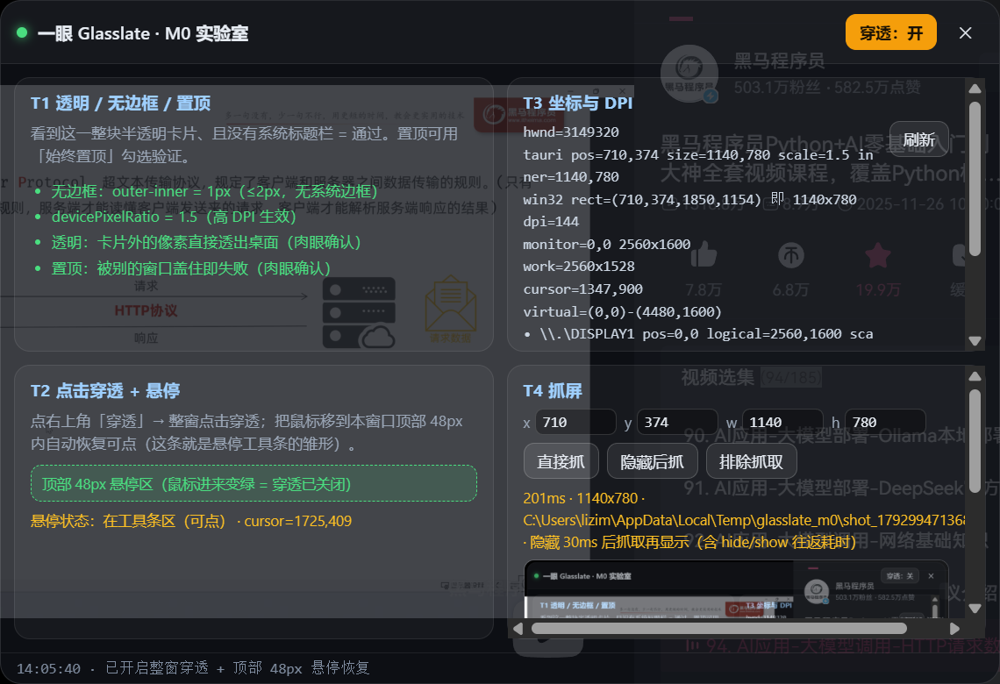
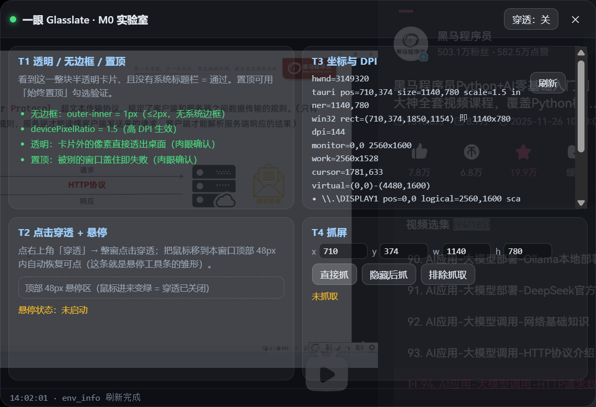
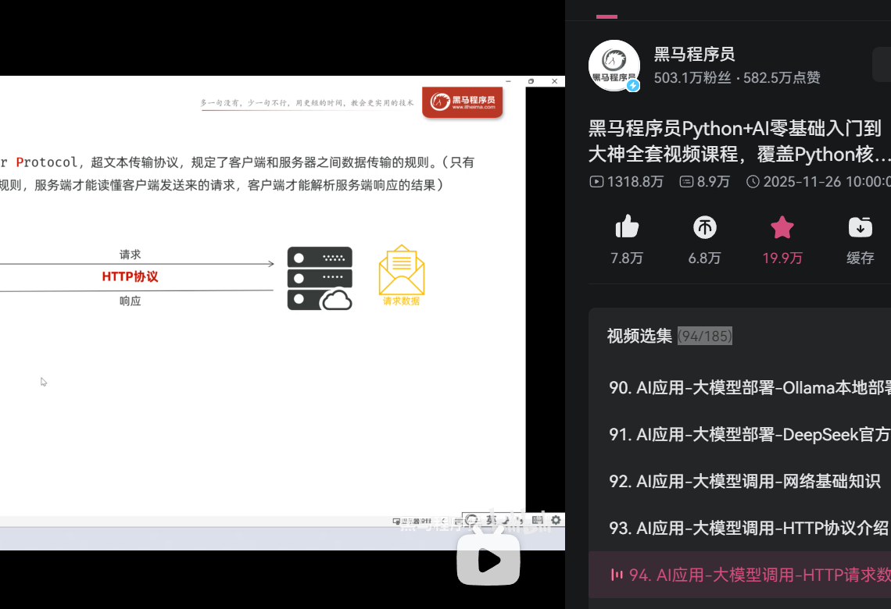

# M0 实测报告 — 一眼 Glasslate（2026-10-26）

> 目的：设计文档 D3–D19 里关于「透明窗口 / 点击穿透 / 高 DPI 坐标 / 抓屏截到自己」的四个假设，
> 在这台真机上全部跑了一遍。**结论：四条主链路全部可行，但其中两条的实现方式要改。**
> 本文所有数据都来自实机运行，不是查资料。

---

## 0. 测试环境

| 项 | 值 |
|---|---|
| 系统 | Windows 11 25H2，build 10.0.26200.0 |
| WebView2 Runtime | 155.0.4283.62 |
| 显示配置 | 主屏 2560×1600 @150%（`\\.\DISPLAY1`，物理 0,0）；副屏 1920×1080 @100%（`\\.\DISPLAY2`，物理 2560,223） |
| 桌面虚拟屏 | (0,0)-(4480,1600)，工作区高 1528 |
| Rust / cargo | 1.99.1（MSVC 目标，无 rustup，用官方 MSI 管理式解包） |
| MSVC | VS Build Tools 17.x，`link.exe` 14.44.35207，Windows SDK 10.0.26100 |
| Tauri | tauri-cli 2.12.4 / tauri 2.x |
| 实验工程 | `YiYan-Glasslate`（vanilla-ts 模板 + 手写 Win32 FFI，未引 `windows` crate） |

测试窗口配置：`760×520` 逻辑像素、`transparent: true`、`decorations: false`、`alwaysOnTop: true`、`shadow: false`、`center: true`。

---

## 1. 结论表

| 任务 | 结论 | 一句话 |
|---|---|---|
| T1 透明 / 无边框 / 置顶 | ✅ 通过 | 三条配置项全部生效，卡片外像素直接透出桌面，没有出现 Tauri #14764 的「幽灵标题栏」 |
| T2 点击穿透 + 动态开关 | ✅ 通过（实现方式改） | **不需要手写 Win32**：`setIgnoreCursorEvents()` 就够；顶部悬停区必须靠**轮询**，因为穿透态下 WebView 收不到 mousemove |
| T3 坐标与 DPI | ✅ 通过（认知要改） | Tauri 的 `outer_position/outer_size` 和 Monitor API **返回的是物理像素**；跨屏时窗口物理尺寸会随 DPI 变 |
| T4 抓屏不截到自己 | ✅ 通过（方案要换） | **`WDA_EXCLUDEFROMCAPTURE` 后直接抓，0 闪烁、0 往返**，比「隐藏→抓→显示」好一个量级 |

---

## 2. T1 透明 / 无边框 / 置顶

```
tauri outer_size = 1140×780（物理）= 760×520（逻辑）× 1.5
inner_size       = 1140×780   → outer - inner = 0（WebView 侧 outerWidth-innerWidth = 1px）
tauri_scale_factor = 1.5 ; devicePixelRatio = 1.5 ; GetDpiForWindow = 144
```

- 窗口无系统标题栏、无边框、圆角由 CSS 画，卡片外像素**完全透明**——底层 PPT / 浏览器内容直接透出来（证据：`img/m0/t1-transparent.png`）。
- `alwaysOnTop` 生效：窗口浮在浏览器之上。
- 未观察到透明窗口拖拽/焦点变化时的「幽灵标题栏背景」（Tauri issue #14764 在本环境未复现），但**保留该风险条目**，因为它是版本相关的。
- `outer - inner = 1px`：WebView 子窗口比窗口小 1px。做原位覆盖时若用 `inner` 尺寸算矩形会差 1px，建议一律用 `outer`（`GetWindowRect`）。

**对文档的修订**：T1 从「1h，含失败应对（改 C# WPF）」降级为「已通过，失败应对只留作历史记录」。


---

## 3. T2 点击穿透 + 动态开关

**结论：整窗穿透用 Tauri 自带 API，1 行；动态恢复可点必须轮询。**

- `window.set_ignore_cursor_events(true)`（JS）/ `set_ignore_cursor_events`（Rust）即可整窗穿透，**无需** `WS_EX_TRANSPARENT` + `WS_EX_LAYERED`。验证方法不是肉眼看，而是 `WindowFromPoint`：
  - 穿透开、光标在窗口中部 → 命中**下层**浏览器窗口（pid 不是本进程）✔
  - 穿透开、光标移到顶部 48px 悬停区 → 轮询线程把 `ignore_cursor_events` 置回 false，`WindowFromPoint` → 本窗口的 WebView 子窗口 ✔
  - 光标移出悬停区 → 恢复穿透 ✔
- **为什么必须轮询**：窗口处于 `WS_EX_TRANSPARENT` 状态时收不到鼠标消息，`mouseenter` / `mousemove` 都不会触发。所以「悬停浮现工具条」在穿透态下只能靠「定时 `GetCursorPos` + 判断是否落在顶部条带内」。
- 实测轮询周期 40ms、条带高度 48 逻辑像素：正常移动鼠标时无可感延迟；快速划过可能有一次 40ms 的判定滞后（可接受，若要更稳可降到 20ms）。

**对文档的修订**：T2 实现方式改写（1.5h → 0.5h），并补一条设计约束：**工具条热区判定不能依赖 DOM 事件，必须在 Rust 侧轮询**。



---

## 4. T3 坐标与 DPI（本次最重要的认知修正）

### 4.1 Tauri 返回的是物理像素，不是逻辑像素

同在 150% 主屏上，同一时刻：

```
tauri  outer_position = 710,374     outer_size = 1140,780
win32  GetWindowRect  = (710,374)-(1850,1154)  → 1140×780
```

**逐像素完全相同**。所以 `outer_position()` / `outer_size()` 已经是物理像素；`scale_factor()` 是「物理/CSS」的倍率，不要再乘它一次。设计文档里「全链路统一用物理像素」是对的，但漏了一句：**Tauri 这一侧本来就是物理的，只有 CSS/DOM 侧是逻辑的**。

Monitor API 同理：`Monitor.position()` / `.size()` 返回物理矩形，`scale_factor()` 单独给倍率。
（本机：DISPLAY1 0,0 2560×1600 @1.5；DISPLAY2 2560,223 1920×1080 @1.0。）

### 4.2 跨屏移动时窗口物理尺寸会变（逻辑尺寸不变）

| 位置 | 显示器 | scale | 物理矩形 | 逻辑尺寸 |
|---|---|---|---|---|
| 主屏居中 | DISPLAY1 | 1.5 | 710,374 → 1140×780 | 760×520 |
| 移到副屏 (2560,400) | DISPLAY2 | 1.0 | 2560,400 → **760×520** | 760×520 |
| 移回主屏 | DISPLAY1 | 1.5 | 710,374 → **1140×780** | 760×520 |

即：`set_position` 只给位置，**DPI 变化的瞬间窗口物理尺寸被系统改成「保持逻辑尺寸」**，且 Tauri 和 Win32 两侧始终一致。

**这条直接决定截图链路的正确写法**：
- 抓屏矩形必须**每次抓前**用 `GetWindowRect`（物理）现取，不能缓存；
- 缓存 CSS 尺寸 × 旧 scale 会在跨屏后截歪；
- 监听 `ScaleFactorChanged` 事件，任何缓存的矩形/字号/抹除块采样全部失效。

### 4.3 其它实测细节

- `center: true` 居中用的是**工作区**（排除任务栏）：x=(2560-1140)/2=710、y=(1528-780)/2=374 ✔
- 窗口左半边跨两个显示器时 DPI 取哪一个，本次**未测**（需要在边界处 straddle，属于边角情况，建议 V1 直接规定「窗口不跨屏」）。
- 200% 缩放未测（本机没有 200% 屏）。

---

## 5. T4 抓屏不截到自己（方案推翻）

同一个 1140×780 矩形，三种做法实测：

| 做法 | 结果 | 耗时 | 评价 |
|---|---|---|---|
| 直接 `BitBlt(SRCCOPY\|CAPTUREBLT)` | **把自己的窗口完整抓进来**（T1/T2/T3/T4 四张卡片全在画面里） | 极快 | ❌ 产品不可用 |
| `hide()` → 等 30ms → 抓 → `show()` | 抓到的画面干净 | **201ms** | ⚠️ 可用但有一次可见闪烁 + 抢焦点风险 |
| `SetWindowDisplayAffinity(hwnd, WDA_EXCLUDEFROMCAPTURE=0x11)` → 直接 `BitBlt` | 抓到的画面干净，**自己的窗口完全不进画面** | 极快 | ✅ **推荐** |

第三条的关键现象：设置亲和性之后**不需要隐藏窗口**，BitBlt 抓出来的就是「窗口不存在」的桌面——底层 PPT 和网页内容直接透出（证据：`img/m0/t4-self-capture.png` 自截态 / `img/m0/t4-excluded.png` 排除态）。

**这解释了产品级的一个更重要的收益**：玻璃窗在译文覆盖态下仍然可以被重新抓取。用户按「重译」时不需要把覆盖层藏起来，不会闪，也不会出现「藏起来的那一帧」被抓到。

**注意（官方限制，别过度承诺）**：
- `WDA_EXCLUDEFROMCAPTURE` 需要 **Windows 10 2004+**；更早系统等同 `WDA_MONITOR`（窗口变黑）。
- 只在 DWM 合成桌面时生效；**手机拍屏照样拍到**，不是安全/DRM 特性。
- 只影响「本进程之后抓自己的画面」类 API（BitBlt / PrintWindow / WGC 大体遵守）。
- 全屏独占 DirectX 游戏用 BitBlt 抓不到（本项未测，属已知限制，V1 不支持）。

**对文档的修订**：T4 从「隐藏-抓-恢复」改为「抓前设置亲和性」，并新增一条产品行为：**重译不再需要隐藏覆盖层**。

| 直接 BitBlt（自截态，❌） | 排除抓取后 BitBlt（✅） |
|---|---|
|  |  |

---

## 6. 顺带踩到的坑（写进 README / 开发文档）

1. **Smart App Control 会拦未签名的 rustup-init.exe**（本机策略 `VerifiedAndReputablePolicyState=1`，事件 ID 3077/3033）。绕过方式：不用 rustup，用官方 MSI 管理式解包 `msiexec /a rust-1.99.1-x86_64-pc-windows-msvc.msi /qn TARGETDIR=...`，解出来的 `rustc.exe`/`cargo.exe` 可正常运行，且不需要 rustup。
2. **VS Build Tools 静默安装可能卡死在 SDK 下载**（本次卡了 18 分钟无进度，`dd_setup` 日志停在某一行、`%TEMP%\gelpansp` 不再增长）；杀掉重装即恢复。CI 上建议直接装好 SDK 或用固定镜像，别赌网络。
3. **PowerShell 5.1 读无 BOM 的 UTF-8 脚本按 ANSI 处理**：辅助脚本里写中文注释会 mojibake 甚至触发语法错误。工程脚本一律 ASCII，或写成 `.ps1` 时存成 UTF-8 with BOM。
4. **DPI 未感知的进程会把所有坐标虚拟化**（150% 下 2560 变成 1707）。脚本侧要尺寸/坐标必须先 `SetThreadDpiAwarenessContext(-4)`，否则 `SetCursorPos` / `WindowFromPoint` / `GetWindowRect` 全都对不上，调试时会误判成「应用坐标错了」。
5. `npm.ps1` 会被执行策略拦，要用 `npm.cmd`。

---

## 7. 未验证 / 下一步

- [ ] 全屏 DirectX 游戏能否抓到（BitBlt 预期不行，WGC 待试）
- [ ] 窗口跨显示器边界时的 DPI 归属
- [ ] 200% 缩放屏
- [ ] 视频/滚动内容下的「内容已变化」检测（设计文档 §2.1 缺失项）
- [ ] OCR 实测：本机系统只有 `zh-Hans-CN` 语言包，英文识别可用但有吞空格/`l→I` 问题（详见评审意见 §1.1）；**D7 已拍板反转为「ONNX 默认 + Windows OCR 快启」**

---

## 8. 对阶段计划的影响

| 项 | 原估 | 实测后 |
|---|---|---|
| T0 环境搭建 | 未列 | 0.5–1 天（含 SAC/VS 装不上的排查，本机实际用了约 2 小时） |
| T1 | 1h | 0.25h（已通，只剩配置） |
| T2 | 1.5h | 0.5h（Tauri API）+ 轮询逻辑 0.5h |
| T3 | 1.5h | 0.5h（但要把「物理/逻辑」写进架构约定，影响所有模块） |
| T4 | 1h | 0.25h（亲和性 1 行 + 每次现取矩形） |

M0 合计：原「约 5 小时」→ 实测「**已通，剩余收尾 < 2 小时**」（不含 T0 环境）。
